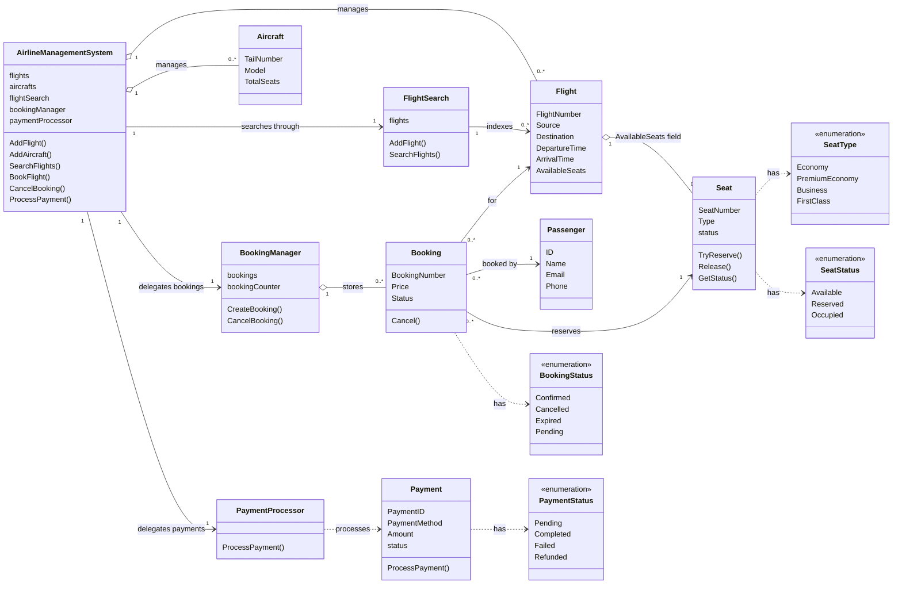

# Airline Management System

A small, in-memory Go implementation of airline flight search, seat booking, cancellation, and simulated payment processing. The module is a design-practice example, not a production booking service.

## Implemented Features

- Register flights and aircrafts with an `AirlineManagementSystem`.
- Search flights by source, destination, and departure calendar date. Route matching is case-insensitive.
- Create a confirmed booking when the flight, passenger, and seat are non-nil, the price is non-negative, and the seat can be reserved.
- Prevent two bookings from reserving the same seat concurrently.
- Cancel a confirmed booking and release its seat. Unknown booking numbers are ignored.
- Process a non-nil payment by changing its status from pending to completed. Payment processing is simulated; no payment provider is contacted.
- Generate booking numbers from the current timestamp and an atomic process-local counter.

## Project Structure

| File | Responsibility |
| --- | --- |
| `airline_management_system.go` | Public facade for flights, aircrafts, search, bookings, and payments |
| `flight.go`, `aircraft.go`, `passenger.go` | Core flight, aircraft, and passenger data types |
| `flight_search.go` | Thread-safe in-memory flight search |
| `booking.go`, `booking_manager.go` | Booking state, ID generation, booking storage, cancellation |
| `seat.go` | Seat states and synchronized reservation/release operations |
| `payment.go`, `payment_processor.go` | Payment state and synchronized simulated processing |
| `types.go` | Seat, booking, and payment enum values |
| `main.go` | Runnable demonstration |
| `airline_management_system_test.go` | Unit tests for search, bookings, concurrency, and payment processing |

## UML Class Diagram



The `Flight.AvailableSeats` field is present in the model, but booking does not currently validate membership in that slice. Seat availability is enforced on the supplied `Seat` object itself.

## Booking and Payment Flows

### Search

`AddFlight` stores each non-nil flight on the system and in its search index. `SearchFlights` scans the index and matches source and destination without case sensitivity, plus the year, month, and day fields of the departure and requested times.

### Booking

`BookFlight` delegates to the singleton `BookingManager`. A successful booking reserves the seat, gets a generated booking number, starts in `BookingStatusConfirmed`, and is stored by that number. Failed validation returns `nil`. `CancelBooking` changes a confirmed booking to cancelled and releases its seat; cancelling it again does not affect a later reservation of that seat.

### Payment

`ProcessPayment` delegates to the singleton `PaymentProcessor`. A non-nil payment is marked completed. Payments are not connected to bookings, and cancellation does not issue a refund.

## Design and Concurrency

- `AirlineManagementSystem` is the facade for the module's operations.
- `BookingManager` and `PaymentProcessor` use package-level `sync.Once` singletons. Their state is shared across all system instances in the process.
- Mutexes protect the flight list/search index, booking map, booking state, seat state, and payment state. Seat reservation uses a single locked check-and-update operation.
- Exported model fields can still be read or changed directly by callers; such access is not automatically synchronized. Callers should avoid concurrent direct mutation.

## Complexity

Let $F$ be the number of indexed flights, $B$ the number of bookings, and $R$ the number of returned search results.

| Operation | Time | Notes |
| --- | --- | --- |
| Add flight | Amortized $O(1)$ | Appends to the system list and search index |
| Search flights | $O(F + R)$ | Linear scan; returning results costs $O(R)$ |
| Create booking | Average $O(1)$ | Seat reservation plus map insertion |
| Cancel booking | Average $O(1)$ | Map lookup plus booking/seat state updates |
| Process payment | $O(1)$ | Updates the in-memory payment status |

The system stores flights, aircrafts, and bookings in memory, requiring $O(F + A + B)$ storage, where $A$ is the number of aircrafts.

## Run and Test

Use a Go toolchain compatible with the version declared in `go.mod` (`go 1.27.3`). From this directory:

```sh
go test ./...
go run .
```

The demo creates flights and aircrafts, searches for a flight, books a seat, and cancels the booking.

## Limitations and Future Work

- Persist flights, aircrafts, passengers, bookings, and payments instead of keeping them only in process memory.
- Associate aircrafts and seats with scheduled flights, and validate that a requested seat belongs to the selected flight.
- Add flight schedule validation, duplicate-flight handling, and richer search filters such as time windows and available seats.
- Connect payment records to bookings and model payment failures, refunds, and cancellation policies.
- Add passenger/staff roles, baggage, crew assignments, booking changes, and authorization.
- Validate monetary values, including non-finite floating-point values; use an exact decimal or integer minor-unit representation for money.
- Add lifecycle APIs for listing bookings and retrieving their status without direct access to internal state.
