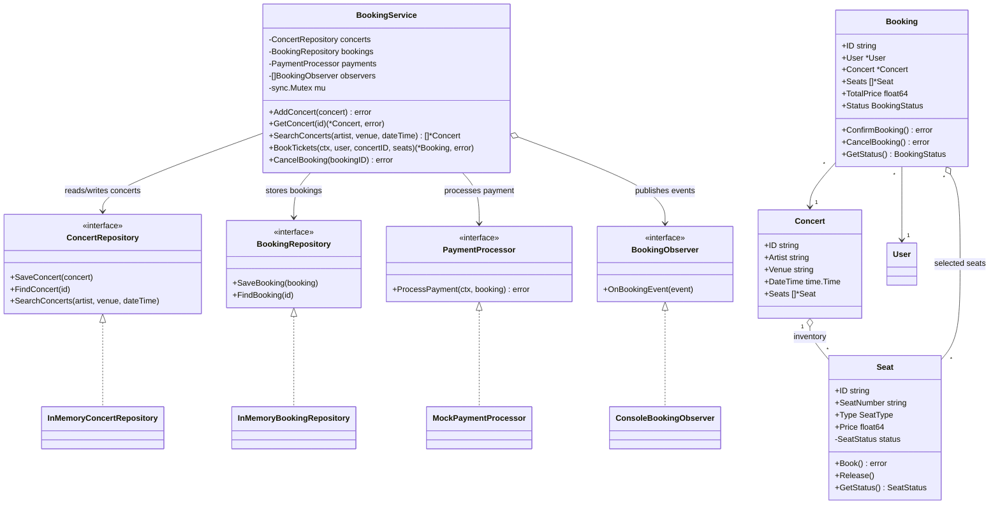
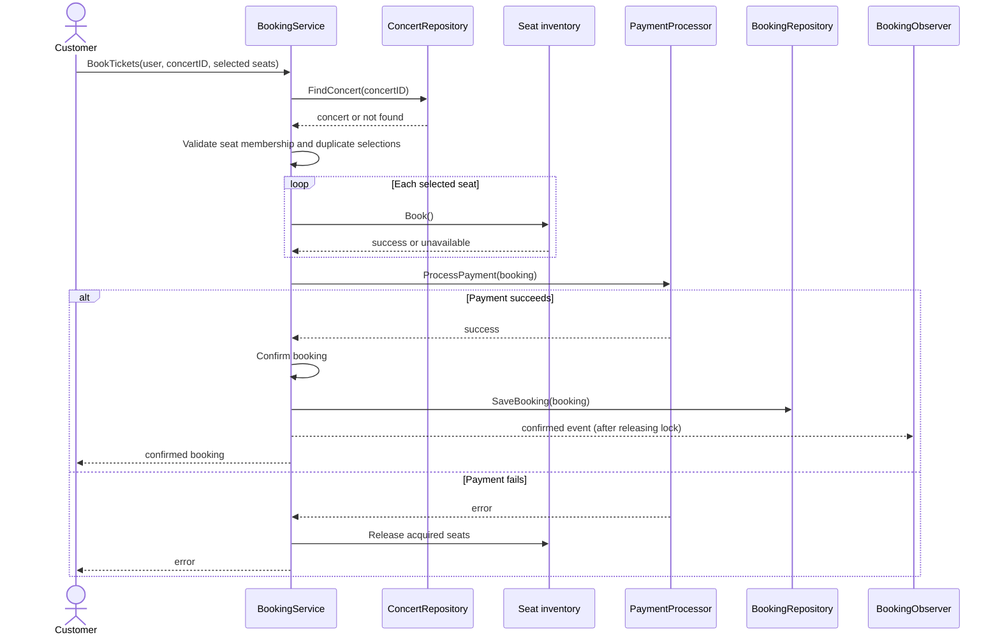

# Concert Ticket Booking System

An in-memory Go implementation of concert discovery, seat booking, payment processing, and cancellation. This design write-up describes the problem scope, assumptions, domain model, key workflows, design decisions, and the limitations of the current implementation.

## 1. Scope

### Functional requirements

- Add, retrieve, and search concerts by artist, venue, and optionally an exact date/time.
- Book one or more seats for a user at a concert.
- Prevent duplicate seat selection and double booking within the running process.
- Process payment before confirming a booking; release acquired seats if booking or payment fails.
- Cancel a confirmed booking and make its seats available again.
- Notify listeners when a booking is confirmed or cancelled.

### Out of scope in this implementation

- User registration/authentication, payment method management, refunds, and payment reconciliation.
- Seat holds with expiration, waiting lists, fairness/queueing, dynamic pricing, and notifications over email/SMS.
- Persistent storage or coordination across multiple application instances.
- A production-safe schedule for multiple roads/sections or a full venue seating map.

## 2. Assumptions

- A concert has a fixed inventory of `Seat` objects, and a selected seat must be the same seat object registered with that concert.
- A seat is either available or booked for the purposes of booking; `StatusReserved` is defined but reservation workflows are not implemented.
- Search uses exact artist, venue, and timestamp comparisons. An empty artist or venue and a zero `time.Time` mean “do not filter by this field.”
- Payment is attempted synchronously. A successful `PaymentProcessor` call means payment succeeded; an error means the booking attempt fails and acquired seats are released.
- Cancellation is allowed only for confirmed bookings. Cancelled bookings remain stored so their final state can be retrieved.
- The in-memory implementation is a single-process learning example, not a distributed inventory system.

## 3. Domain Model

- **Concert** has an ID, artist, venue, date/time, and its seat inventory.
- **Seat** has an ID, label, type, price, and synchronized availability state.
- **User** identifies the customer for a booking.
- **Booking** associates one user and concert with selected seats, total price, and a pending/confirmed/cancelled status.
- **BookingService** coordinates use cases; repositories provide storage; payment and observer interfaces isolate external behaviors.

### UML class diagram



## 4. Architecture and Design Decisions

The code is organized by responsibility within the Go package:

| Area | Files | Responsibility |
| --- | --- | --- |
| Domain | `concert.go`, `seat.go`, `booking.go`, `user.go`, `types.go` | Concert, seat, user, booking, and state types |
| Application | `booking_service.go` | Use-case orchestration and booking rules |
| Persistence boundary | `repositories.go` | Repository contracts and in-memory adapters |
| External behavior boundaries | `payment.go`, `notification.go` | Payment processing and booking event listeners |
| Construction/demo | `utils.go`, `main.go` | Default seat factory and executable composition root |
| Validation | `booking_service_test.go` | Booking, rollback, cancellation, and concurrency behavior |

### Patterns used

- **Repository:** `BookingService` depends on `ConcertRepository` and `BookingRepository` interfaces, rather than directly owning maps. The in-memory adapters can be replaced by database-backed implementations.
- **Strategy:** `PaymentProcessor` selects a payment behavior at runtime. The mock processor is for the demo/tests; a real adapter can implement the same contract.
- **Observer:** `BookingObserver` separates confirmation/cancellation side effects from booking logic. Observers are called after the service lock is released.
- **Factory function:** `GenerateSeats` centralizes example seat creation and default tier prices. A full factory abstraction is not necessary for the current single construction path.
- **Application service / facade:** `BookingService` provides a small use-case API and coordinates repositories, seat state, payment, and events.
- **Dependency injection:** `NewBookingService` receives its collaborators. There is no global singleton, keeping separate instances testable and allowing different adapters to be composed.

The implementation does not add patterns where they would only add indirection. For example, there is no separate abstract factory for three seat tiers, nor a state-class hierarchy for the small booking and seat state sets.

## 5. Main Workflows

### Booking



### Cancellation

1. Find the booking by ID; return an error if it does not exist.
2. Transition it from confirmed to cancelled; reject invalid state transitions.
3. Release its seats and persist the updated booking.
4. Publish the cancellation event after the service lock is released.

## 6. Consistency and Concurrency

- In-memory repositories protect their maps with `sync.RWMutex`.
- `Seat` protects its status, and `Booking` protects its lifecycle status.
- One `BookingService` instance serializes the whole booking and cancellation workflow with a mutex. This prevents competing requests through that same instance from interleaving seat acquisition and booking state changes.
- The service mutex is currently held while calling the payment processor. This is simple and keeps the in-process workflow serialized, but a slow payment provider blocks other booking/cancellation requests handled by that instance.
- This guarantee is **per service instance and process only**. Multiple service instances, program processes, or hosts sharing inventory are not coordinated by these mutexes. Production inventory needs transactional persistence or another cross-instance reservation mechanism.
- Entity fields such as `Booking.Status`, `Concert.Seats`, and seat pricing are exported for this example. Callers must not directly mutate them concurrently; a production design would encapsulate mutable state more strictly.

## 7. Complexity

Let `C` be the number of concerts, `S` the number of seats in a concert, and `K` the number of selected seats.

| Operation | Time | Explanation |
| --- | --- | --- |
| Add / retrieve concert | O(1) average | Map lookup or update by concert ID |
| Search concerts | O(C) | Linear scan of in-memory concerts |
| Validate selected seats | O(S + K) | Build inventory index, then validate each requested seat |
| Book / cancel | O(K) plus payment latency | Update selected seats; booking also includes validation and external payment |

## 8. Running and Testing

Run the sample composition from this directory:

```sh
go run .
```

Run the tests:

```sh
go test ./...
```

The driver creates an in-memory service, adds and searches a sample concert, books two seats with mock payment, and cancels the booking. Tests cover failed-payment seat release, rollback after an unavailable seat, competing booking attempts, and cancellation.

## 9. Gaps and Production Evolution

- **Payment uncertainty:** A network error may occur after a provider has charged the customer. Production payment needs idempotency keys, payment status reconciliation, and compensating refunds/voids when necessary.
- **Lock scope:** Holding a service-wide lock during payment limits throughput. A production workflow would use expiring seat holds and a durable state machine, avoid network calls inside a critical section, and finalize inventory transactionally.
- **Storage and identity:** Replace in-memory repositories and sequential process-local booking IDs with durable storage and globally unique IDs.
- **Multiple instances:** Enforce seat exclusivity in the persistence layer using transactions/unique constraints or a distributed reservation protocol.
- **Reservation lifecycle:** Implement timed holds and release expired holds; the `StatusReserved` value alone does not provide reservation behavior.
- **Additional product requirements:** Add refunds and cancellation policies, user/payment validation, venue layouts, price/fee policies, waiting lists, fairness rules, and reliable asynchronous notifications as required.
