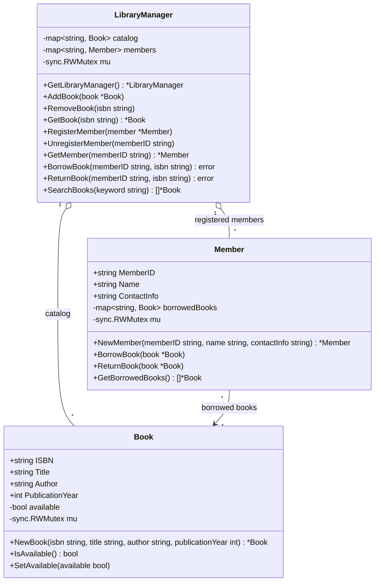

### Library Management System

#### 1. Requirement Gathering

- Functional Requirement
    - Maintain a catalog of books indexed by ISBN and members indexed by member ID.
    - Add and remove books; register and unregister members.
    - Retrieve books or members by their identifiers and search books by title or author.
    - Allow a registered member to borrow an available book and return a book.
    - Limit a member to five borrowed books.
- Non-Functional Requirement
    - Protect catalog, member, and book availability / borrowed-book state against concurrent access using Go mutexes.
    - Keep the in-memory implementation extensible for future persistence and library policies.

#### 2. Core Identity
- `Book` stores ISBN, title, author, publication year, and availability. `IsAvailable` and `SetAvailable` guard availability with an `sync.RWMutex`.
- `Member` stores member ID, name, contact information, and borrowed books keyed by ISBN. Its methods guard the borrowed-book map with an `sync.RWMutex`.
- `LibraryManager` owns the catalog and member maps and provides the library operations. `GetLibraryManager` returns the process-wide manager, initialized once with `sync.Once`.
- The manager coordinates borrowing and returns by updating the member's borrowed-book map and the book's availability together while holding its write lock.

#### 3. Design & Usage

The implementation is in the Go `main` package:

| File | Responsibility |
| --- | --- |
| `book.go` | Book data and thread-safe availability access |
| `member.go` | Member data and thread-safe borrowed-book operations |
| `library_manager.go` | Singleton manager, catalog/member operations, search, borrowing rules |
| `main.go` | Runnable example |

##### UML Class Diagram



Example flow in `main.go`: create and add books, register members, borrow and return books, then search by title or author. Borrowing fails with an error if the member or book does not exist, the book is unavailable, or the member already has five books.

Run the example from this directory:

```sh
go run .
```

Run package tests (there are currently no dedicated tests in this directory):

```sh
go test ./...
```

#### 4. Design Patterns & Principles

- **Singleton:** `GetLibraryManager` uses `sync.Once` to provide one manager instance per process.
- **Facade:** `LibraryManager` exposes catalog, member, search, borrow, and return operations over the underlying maps and entities.
- **Encapsulation:** `Book` availability and `Member` borrowed-book storage are private and accessed through methods.
- **Single responsibility:** Book availability, member borrowing records, and library-level coordination reside in separate types.

#### 5. Concurrency & Thread Safety

- `LibraryManager.mu` is an `sync.RWMutex`; map reads use a read lock and mutations use a write lock.
- `Book.mu` protects availability, and `Member.mu` protects borrowed books. Their read methods use read locks.
- Manager borrow/return operations take the manager write lock before acquiring a member or book lock, serializing those workflows and preventing concurrent borrows of the same catalog entry.
- The exported book and member fields can be accessed directly by callers. Callers must avoid unsynchronized concurrent writes to those fields; the entity mutexes protect only the private state described above.

#### 6. Algorithmic Complexities (Core Flows)

Let `B` be the number of catalog books, `M` the number of members, `K` the number of books borrowed by a member, and `Q` the number of books returned by a search.

| Operation | Time | Notes |
| --- | --- | --- |
| Add / get / remove book | O(1) average | Catalog is a map keyed by ISBN |
| Register / get / unregister member | O(1) average | Members are stored in a map keyed by member ID |
| Borrow / return | O(K) | Map operations are O(1) average; borrowing checks the borrowed-book count by creating a slice through `GetBorrowedBooks` |
| Search books | O(B) | Scans each title and author; returns up to Q matches |
| Borrowed-book snapshot | O(K) | Copies map values into a slice |

#### 7. Open Issues & Future Extensions

- `loanDurationDays` is declared but not currently enforced; there are no due dates, renewals, or overdue tracking.
- `ReturnBook` currently succeeds even if the member did not borrow that book, and marks it available. Validate the member's borrowing record before changing availability.
- The implementation has no update-book operation, duplicate-ID validation, persistence, reservations, fines, or audit history.
- Add tests for unavailable books, unknown IDs, the five-book limit, return validation, search matching, and concurrent borrow attempts.
- Consider returning errors from add/remove/register operations and controlling access to exported entity fields if the manager is used outside the example.
