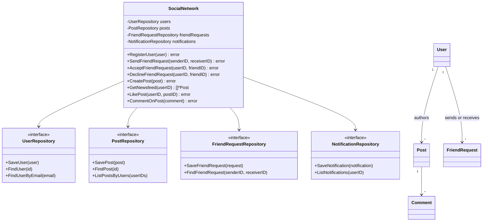

# Social Networking Service

An in-memory Go implementation of user profiles, friend requests, posts, newsfeeds, likes, comments, and notifications. The code follows the service/repository separation used by the concert ticket booking example: the service coordinates use cases, while repository interfaces isolate storage.

## 1. Scope

### Functional requirements

- Register users, prevent duplicate IDs/emails, log in, and update profile details.
- Send, accept, and decline friend requests; accepted friendships are reciprocal.
- Create posts containing text, image URLs, and video URLs.
- Build a reverse-chronological feed from the user's own and friends' posts.
- Like/unlike posts, comment on posts, and retrieve post reactions and notifications.
- Notify users about incoming friend requests, accepted requests, likes, and comments.

### Out of scope

- Persistent or distributed storage, user sessions, password recovery, media upload/processing, feed ranking, blocking/privacy controls, and delivery through push/email providers.
- Unfriending, editing/deleting posts, and pagination.

## 2. Assumptions and limitations

- IDs are supplied by callers for users, posts, and comments. The service generates IDs for friend requests and notifications.
- Email matching is case-insensitive. Friend requests are directional, and only the recipient can accept or decline a pending request.
- The feed includes only posts by the user and accepted friends; posts are ordered newest first, with post ID as a deterministic tie-breaker.
- Repositories are in-memory and safe for concurrent calls within one process. This is a learning example, not a distributed social network.
- Passwords are plain strings in this demo. Production authentication must use a dedicated password-hashing scheme, secure sessions, and appropriate transport/storage protections.
- The public entity fields are intended for a small example. A production API should use immutable DTOs and avoid exposing mutable account data.

## 3. Domain model

- **User** stores profile data and synchronized friend/post collections.
- **FriendRequest** tracks sender, recipient, status, and creation time.
- **Post** stores authored content, media URLs, likes, and comments.
- **Comment** and **Notification** are timestamped records.
- **SocialNetwork** coordinates validation and workflows through repository interfaces.
- **In-memory repositories** provide thread-safe user, post, friend-request, and notification storage.



## 4. Usage

Create a service with in-memory repositories:

```go
network, err := NewSocialNetwork(
    NewInMemoryUserRepository(),
    NewInMemoryPostRepository(),
    NewInMemoryFriendRequestRepository(),
    NewInMemoryNotificationRepository(),
)
if err != nil {
    log.Fatal(err)
}

alice := NewUser("user-1", "Alice", "alice@example.com", "demo-password", "", "Hello!")
bob := NewUser("user-2", "Bob", "bob@example.com", "demo-password", "", "")
if err := network.RegisterUser(alice); err != nil {
    log.Fatal(err)
}
if err := network.RegisterUser(bob); err != nil {
    log.Fatal(err)
}
if err := network.SendFriendRequest(alice.ID, bob.ID); err != nil {
    log.Fatal(err)
}
if err := network.AcceptFriendRequest(bob.ID, alice.ID); err != nil {
    log.Fatal(err)
}
```

Run the demo and tests from this directory:

```sh
go run .
go test -race ./...
```

The demo constructs its own service and in-memory repositories through dependency injection. `GetSocialNetwork()` remains available for callers that specifically want a process-wide singleton; prefer `NewSocialNetwork` for isolated services and tests.

## 5. Concurrency and complexity

- Repository maps and entity-owned friend/post/like/comment collections use read/write locks.
- The service serializes multi-step writes so duplicate registration, friend-request transitions, and post mutations cannot interleave within one instance.
- User lookup by ID/email is O(1) in the in-memory implementation. Feed generation scans stored posts and sorts the matching posts: O(P + F log F), where P is all stored posts and F is the returned feed size.
- Like insertion and friend membership checks are O(1) average; comment ID validation is O(C), where C is the post's comment count.

## 6. Design principles

- Service/repository separation allows alternate persistence implementations.
- Interfaces isolate storage from use-case coordination.
- Sentinel errors support caller checks with `errors.Is`.
- Notifications are emitted by the service as domain events are completed; external delivery is intentionally not coupled to storage.

## 7. Future extensions

- Add persistent repositories, transactions, and cross-instance request coordination.
- Use password hashing, authenticated sessions, profile visibility, blocking, and authorization checks.
- Add cursor-based feed pagination, feed fan-out strategies, and media storage.
- Add notification delivery adapters and retries.
