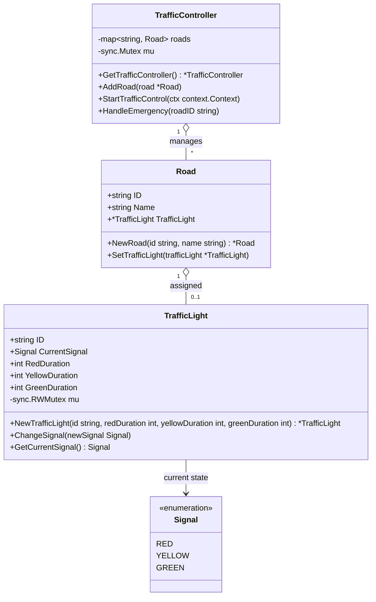

# Traffic Signal Control System

## 1. Requirements

### Functional

- Manage roads and their assigned traffic lights.
- Cycle each light through red, green, and yellow using configurable durations.
- Allow an emergency request to set a road's light to green.

### Non-functional

- Run independent signal cycles concurrently.
- Protect controller and traffic-light state from concurrent access.
- Stop the signal-cycle timers when the process receives Ctrl+C.

## 2. Core Types

- `TrafficController` stores roads by ID and provides the process-wide instance through `GetTrafficController`.
- `Road` identifies a road and holds its assigned `TrafficLight`.
- `TrafficLight` stores its signal and phase durations. `GetCurrentSignal` safely reads its current signal.
- `Signal` defines the `RED`, `YELLOW`, and `GREEN` values.

## 3. Class Diagram



## 4. Example and Running

`main.go` creates four roads and lights. Each light starts in the red state and cycles independently:

1. Wait for `RedDuration`, then change to green.
2. Wait for `GreenDuration`, then change to yellow.
3. Wait for `YellowDuration`, then change to red and repeat.

Durations are in milliseconds. The example configures 6 seconds red, 9 seconds green, and 3 seconds yellow. After 10 seconds it calls `HandleEmergency("R2")`, which immediately sets that road's light to green. The normal cycle continues afterward.

Run from this directory:

```sh
go run .
```

The program remains active after the emergency event. Press **Ctrl+C** to stop it; the context cancels each light's timer so its cycle can exit.

Run tests:

```sh
go test ./...
```

## 5. Design Patterns and Principles

- **Singleton:** `GetTrafficController` uses `sync.Once` to initialize one controller for the process.
- **Encapsulation:** `TrafficController` owns the road map, while `TrafficLight` provides methods for changing and safely reading its state.
- **Concurrency:** the controller launches one cycle goroutine per assigned light; a shared context provides shutdown cancellation.

## 6. Concurrency and Thread Safety

- `TrafficController.mu` protects the road map. `StartTrafficControl` takes a snapshot of its lights while locked, then releases the lock before starting cycles.
- `TrafficLight.mu` protects signal changes and reads through `GetCurrentSignal`.
- Read `CurrentSignal` via `GetCurrentSignal` when accessing it concurrently. The field remains exported for this example, so direct concurrent access is not protected.
- Road fields, light configuration fields, and the singleton map are intended to be configured before starting traffic control. Mutating them concurrently is not synchronized.

## 7. Complexity

Let `R` be the number of roads:

| Operation | Time | Notes |
| --- | --- | --- |
| Add road | O(1) average | Inserts into a map by road ID |
| Start control | O(R) | Snapshots roads and launches one goroutine per assigned light |
| Handle emergency | O(1) average | Looks up one road and changes its light |
| Signal transition | O(1) | Updates and reports one light's signal |

The controller uses O(R) additional space for its road map and O(R) goroutines for active lights.

## 8. Limitations and Future Work

- Every road cycles independently, so this is a demonstration rather than a safe intersection scheduler. It does not prevent conflicting roads from being green simultaneously.
- Emergency handling only changes the selected light to green; it does not coordinate other roads or hold priority for a defined period.
- The controller does not support removing roads, changing timings at runtime, or validating duration values.
- Add tests for phase transitions, cancellation, emergency requests, and conflicting signal coordination.
